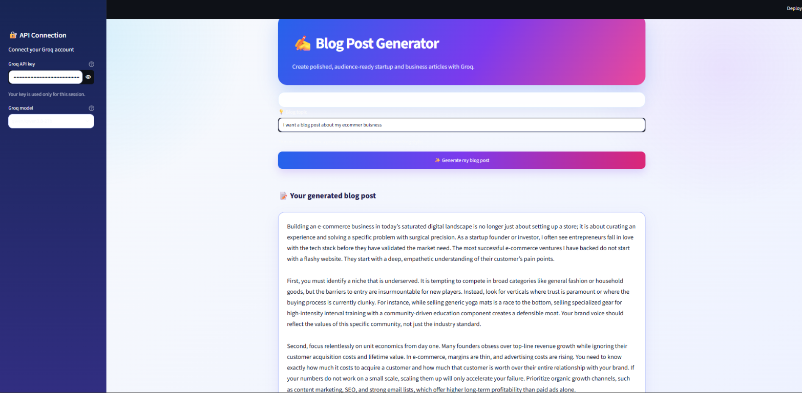

# Blog Post Generator

Blog Post Generator is a polished Streamlit application that creates
startup-oriented, 400-word blog posts from a topic entered by the user. It uses
the Groq API and LangChain, dynamically discovers text-generation models
available to the supplied API key, and presents the result in a readable card.

## Preview



The interface includes:

- A blue, purple, and pink gradient header
- A dark gradient API connection sidebar
- Password-protected Groq API-key input
- A dynamically loaded Groq model selector
- A dedicated blog-topic input
- A full-width gradient generate button
- A loading indicator
- A light, readable generated-post panel
- Visible validation and API error messages

## Features

- Generates approximately 400-word startup and venture-capital articles
- Uses each user's own Groq API key
- Retrieves models available to the current Groq account
- Provides a model selector in the sidebar
- Supports Groq text response strings and structured response blocks
- Includes authentication, bad-request, model-not-found, and unexpected-error handling
- Uses a maximum token setting of 2048
- Applies a fixed temperature of 0.7 for balanced creative output
- Escapes and safely renders generated HTML text

## Requirements

- Python 3.13.13
- Streamlit
- LangChain Core
- LangChain Groq
- Groq Python SDK
- python-dotenv

Install all project dependencies from the repository root:

```powershell
pip install -r requirements.txt
```

The root requirements file includes:

```text
streamlit
langchain-core
langchain-groq
python-dotenv
```

## Groq API setup

1. Create or open an account at [Groq Console](https://console.groq.com/).
2. Open [API Keys](https://console.groq.com/keys).
3. Create a new API key.
4. Enter the key in the **Groq API key** field in the left sidebar.
5. Wait for the **Groq model** selector to load.
6. Select a model available to the API key.

Groq keys generally begin with `gsk_`. The key is password-protected in the UI
and is used only for the active session. It is not embedded in the source code.

Never commit an API key to Git or share it publicly. Revoke an exposed key
and create a replacement.

## Installation

From the project root, create a Python 3.13 Conda environment:

```powershell
conda create -n llmapp python=3.13.13 -y
conda activate llmapp
pip install -r requirements.txt
```

## Run the application

From the repository root:

```powershell
streamlit run Blog_Post_Generator\main.py
```

Open the local address printed by Streamlit, normally:

```text
http://localhost:8501
```

## How to use

1. Enter a Groq API key in the left sidebar.
2. Wait for the available Groq models to appear.
3. Select a model from **Groq model**.
4. Enter a blog topic in the topic field.
5. Select **Generate my blog post**.
6. Wait while the loading indicator is displayed.
7. Read or copy the generated post from the result card.

### Example topic

```text
I want a blog post about my ecommerce business
```

### Example generated structure

The prompt asks the model to:

1. Write an experienced startup and venture-capital-style blog post.
2. Produce approximately 400 words.
3. Print the completed article.
4. Add a word count in this format:

```text
This post has X words.
```

## Optional model environment setting

You may set a preferred model in `.env`:

```dotenv
GROQ_MODEL=your-available-model-id
```

The model selector will prefer `GROQ_MODEL` when that exact model is available.
Otherwise, it prefers a model containing `llama-3.3`, then falls back to the
first text model returned for the API key.

This setting is optional. A model must be available to the account associated
with the entered API key.

## Project structure

```text
Blog_Post_Generator/
├── main.py
├── README.md
└── assets/
    └── blog-post-generator-ui.png
```

## Troubleshooting

### No models appear

- Verify that the API key is active.
- Confirm the key belongs to a Groq account.
- Check your internet connection.
- Remove an incorrect `GROQ_MODEL` value if it conflicts with available models.

### Invalid API key

The sidebar will report an invalid or inactive key. Create a new key from the
Groq Console and enter it again.

### Model unavailable

Select another model from the sidebar. Model availability can differ by account,
region, and Groq service tier.

### No blog text is returned

Try another available model. The app reports an empty response explicitly and
supports text in both string and structured Groq response formats.

### Theme or contrast issue

Use a normal browser refresh or a hard refresh:

- Windows: `Ctrl + Shift + R`
- Or restart the Streamlit server:

```powershell
streamlit run Blog_Post_Generator\main.py
```

## Security

- Do not place API keys in `main.py`.
- Do not commit `.env` files containing credentials.
- Enter personal API keys through the password-protected UI.
- Rotate credentials immediately if they are exposed.
