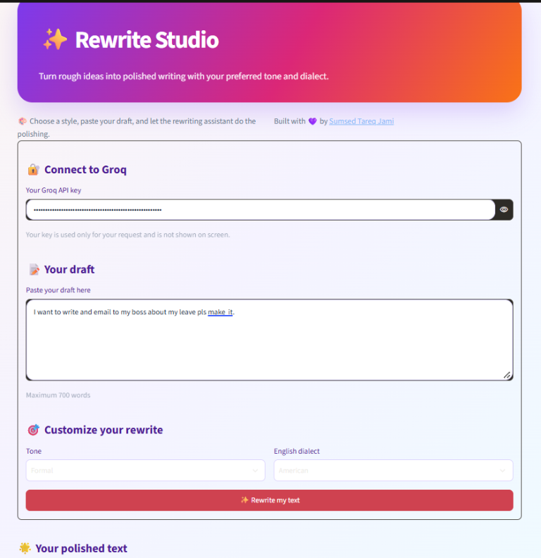
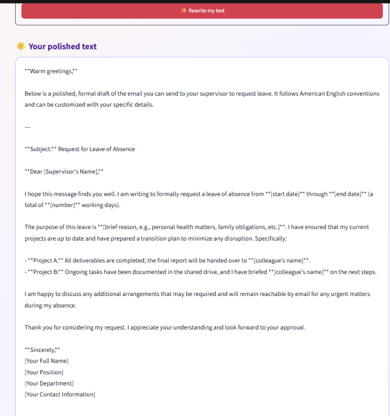

# Rewrite Studio

Rewrite Studio is a Streamlit application that uses Groq-hosted language
models to improve draft writing. It can rewrite text in a formal or informal
tone and adapt it to American or British English.

## Features

- Colorful, responsive Streamlit interface
- Groq API key entry for each session
- Formal and informal tone options
- American and British English dialect options
- 700-word input limit
- Clear validation and API error messages
- Styled, readable rewritten output

## User interface

### Rewrite form



### Rewritten result



## Requirements

- Python 3.13.13
- A Groq API key from [Groq Console](https://console.groq.com/keys)

## Installation

Create and activate the Conda environment:

```powershell
conda create -n llmapp python=3.13.13 -y
conda activate llmapp
```

Install the dependencies:

```powershell
pip install -r requirements.txt
```

## Run the application

From the project root, run:

```powershell
streamlit run Reduction_Improver\main.py
```

Then open the local URL shown in the terminal.

## Configuration

Enter your own Groq API key in the application form. The key is not displayed
as a default value and is not loaded from `.env`.

The default model is `openai/gpt-oss-120b`. To use another Groq-supported model,
set `GROQ_MODEL` in `.env`:

```dotenv
GROQ_MODEL=llama-3.3-70b-versatile
```

Never commit API keys to source control. If a key is exposed, revoke it and
create a replacement in the Groq Console.

## Example input

```text
Please, please, please, my customer, buy my product.
```

Choose a tone and dialect, then select **Rewrite my text** to generate the
improved version.
